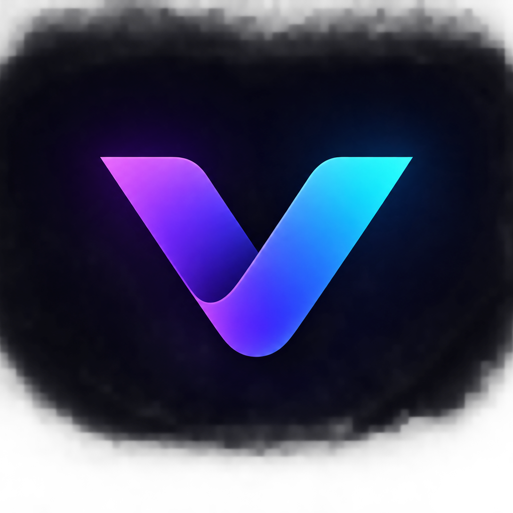
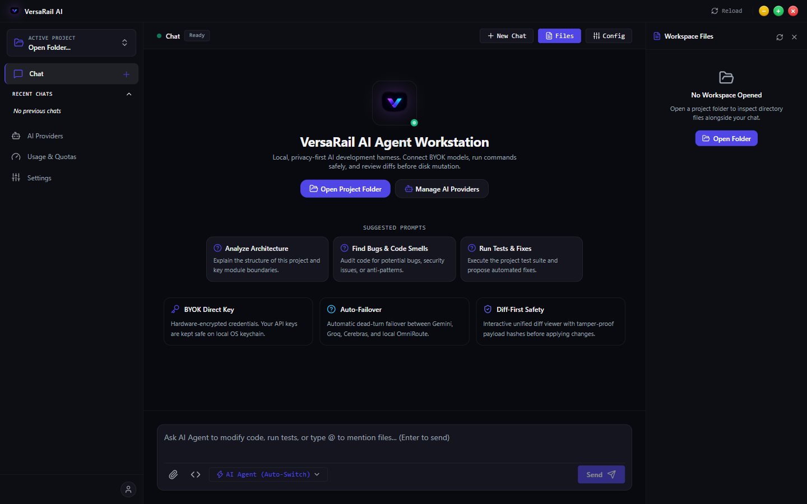
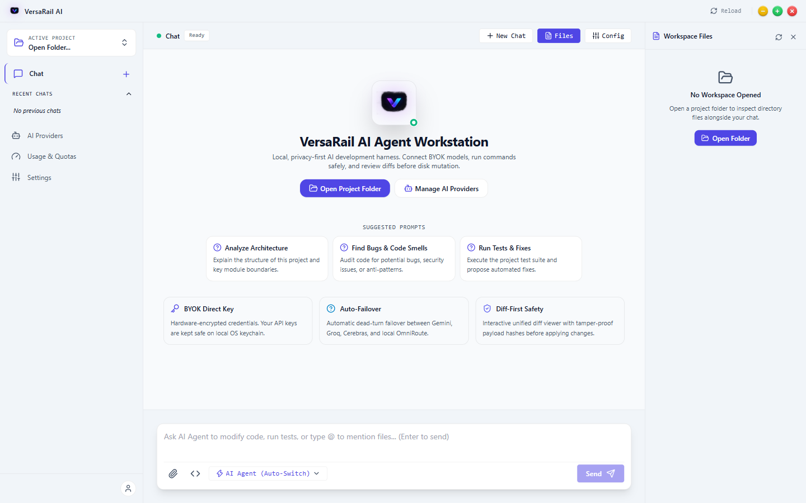
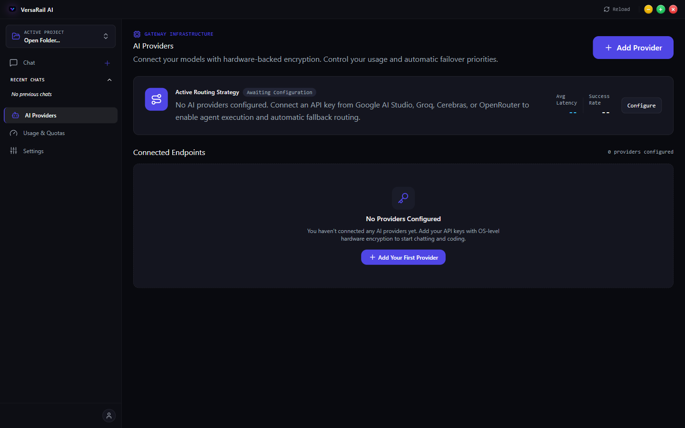
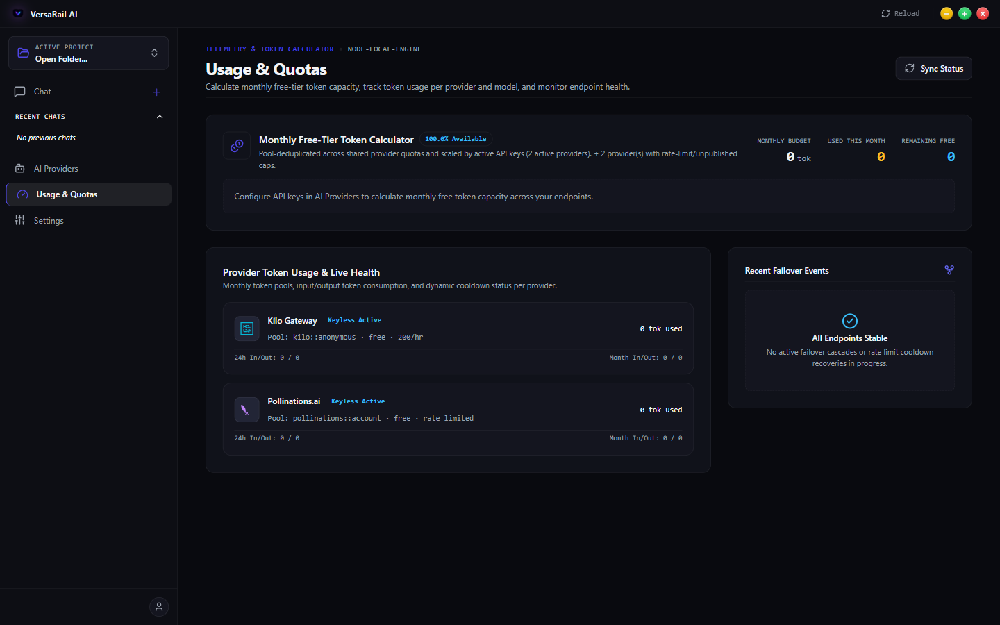

<p align="center">
  
</p>

<h1 align="center">VersaRail AI</h1>

<p align="center">
  <strong>Local-first desktop AI coding workstation with multi-provider failover, quota tracking, and diff-first security.</strong><br>
  13+ AI providers. No monthly subscription. Hardware-encrypted credentials. 100% private to your machine.
</p>

<p align="center">
  <a href="#-quickstart"><strong>Quickstart</strong></a>
  ·
  <a href="#-key-features"><strong>Key Features</strong></a>
  ·
  <a href="#-supported-ai-providers"><strong>Supported Providers</strong></a>
  ·
  <a href="#-light--dark-themes"><strong>Themes</strong></a>
  ·
  <a href="#-security--privacy-architecture"><strong>Security Architecture</strong></a>
  ·
  <a href="#-packaging-desktop-installers"><strong>Desktop Installers</strong></a>
  ·
  <a href="docs/ARCHITECTURE.md"><strong>Architecture Spec</strong></a>
</p>

<p align="center">
  <a href="LICENSE"></a>
  <a href="package.json"></a>
  <a href="package.json"></a>
  <a href="package.json"></a>
  <a href="package.json"></a>
  <a href="docs/SECURITY_THREAT_MODEL.md"></a>
</p>

<p align="center">
  <sub>Free &amp; Open Source · Windows 10/11 x64 · macOS Apple Silicon &amp; Intel · Linux AppImage &amp; DEB</sub>
</p>

<p align="center">
  <picture>
    <source media="(prefers-color-scheme: dark)" srcset="docs/assets/versarail_screenshot_dark.png">
    <source media="(prefers-color-scheme: light)" srcset="docs/assets/versarail_screenshot_light.png">
    
  </picture>
</p>

---

## ⚡ Why VersaRail AI?

Most AI coding assistants lock you into a single proprietary cloud subscription ($20+/mo), send your private source code to external vendor servers, and stall out when you hit tight hourly rate limits.

**VersaRail AI** is a **local-first desktop workstation** designed for developers who demand complete sovereignty over their code, API keys, and workflow:

- **13+ AI Providers in One App**: Connect free-tier models, commercial APIs (BYOK), and local offline LLMs (Ollama, LM Studio) without vendor lock-in.
- **Intelligent Auto-Failover Mesh**: When upstream endpoints return rate-limit errors (`429`) or server overload (`5xx`), VersaRail automatically cascades to healthy fallback models mid-conversation while preserving full context.
- **Diff-First Safety & TOCTOU Protection**: Every file modification generates reviewable unified diffs before disk mutation. Approvals are cryptographically tied to SHA-256 payload hashes to block Time-of-Check to Time-of-Use tampering.
- **Built-in Token Calculator & Quota Tracking**: Calculate your combined monthly free-tier token headroom across all configured providers, track 24-hour and monthly input/output token usage locally, and monitor live endpoint cooldowns.
- **Zero Cloud Telemetry**: All data stays on your machine. API keys are hardware-encrypted using your OS keyring (`safeStorage`), and conversation histories are persisted locally in Node's native `node:sqlite`.
- **Pure Node 24 Native Stack**: Built on `node:sqlite` — **no Python, no MSBuild, and no native C++ node-gyp toolchain required** to install and run.

---

## 🌗 Light & Dark Themes

VersaRail AI features meticulously designed dark and light themes, plus themed character presets (Batman, Iron Man, Spider-Man) with custom animated SVG insignias and ambient sound effects.

| VersaRail Dark (Default) | VersaRail Light |
| :---: | :---: |
|  |  |

<p align="center">
  <em>Toggle effortlessly between Dark, Light, or System sync in Settings, or customize character themes with adjustable atmosphere opacity.</em>
</p>

---

## ✨ Key Features

### 1. 🔄 Multi-Provider Mesh & Automatic Failover
- **13 Supported Provider Adapters**: Native integration with Google Gemini, Groq, Cerebras, OpenRouter, Mistral AI, NVIDIA NIM, Cohere, DeepSeek, Cloudflare Workers AI, Hugging Face, custom OpenAI-compatible endpoints (Ollama, LM Studio, vLLM), plus keyless Pollinations & Kilo Gateway.
- **Universal Free Mesh (`AI Agent`)**: An automated meta-provider that rotates across healthy free-tier endpoints. If an endpoint encounters rate limits (`429`) or server capacity exhaustion (`503`), the engine fails over to the next eligible provider seamlessly before token streaming starts.
- **Live Endpoint Health & Cooldowns**: Evaluates upstream `Retry-After` headers and tracks dynamic cooldowns so recovered providers automatically rejoin the pool.

### 2. 🛡️ Diff-First File Mutation & TOCTOU Protection
- **Unified Diff Reviewer**: Visualizes additions and deletions before any file on disk is modified.
- **Atomic File Writes**: Writes proposed changes to sibling temporary files, flushes buffers to disk via `fsync`, and performs an atomic rename to prevent file corruption.
- **External Edit Conflict Detection**: Verifies target file SHA-256 hashes against pre-edit baseline hashes, preventing overwrite collisions if a file was edited externally (e.g. in VS Code or via Git).
- **Cryptographic Approval Token**: Approval dialogs generate a SHA-256 signature over the exact payload; execution is rejected if arguments are altered between user review and dispatch.

### 3. 📊 Per-Provider Token Calculator & Quota Tracking
- **Monthly Free-Tier Budget Aggregation**: Calculates combined monthly free token capacity across enabled API keys, automatically deduplicating shared account pools (`gemini::ai-studio`, `cerebras::shared`, `openrouter::free`).
- **Real-Time Token Auditing**: Records upstream prompt and completion tokens via provider metadata (`usageMetadata` / OpenAI SSE `include_usage`) with local token estimation fallback.
- **Local Storage (`node:sqlite`)**: Token logs, conversations, and usage records are stored entirely on your computer with zero external telemetry.

### 4. 💻 Workspace-Aware Autonomous Agent
- **Full Project Context**: Open any directory; the agent traverses project trees, discovers files, and respects your `.gitignore` and privacy exclusion filters.
- **Interactive `@` File Mentions**: Type `@` in the prompt composer to reference specific files and inject their content into the context window.
- **Built-in Developer Tool Suite**:
  - `read_file` & `write_file` — Canonical path-checked workspace I/O.
  - `edit_file` — Diff-first hunk patching with atomic rollbacks.
  - `list_directory` & `file_search` — Regex and glob-based file tree exploration.
  - `execute_command` — Sandboxed shell execution with process-tree cleanup.
  - `web_search` — Real-time documentation and reference lookup.
  - `task_complete` — Structured agent turn termination and summary report.

### 5. 🔒 Hardened Electron Security Architecture
- **OS-Encrypted Credentials**: API keys are encrypted at rest using Electron `safeStorage` (Windows DPAPI, macOS Keychain, Linux Secret Service).
- **Process Sandboxing**: Chromium renderer runs with `contextIsolation: true`, `nodeIntegration: false`, `sandbox: true`, and strict Content Security Policy (`connect-src 'none'` in production).
- **Electron Security Fuses**: Built with `@electron/fuses` disabling `runAsNode`, Node CLI inspect flags, and cookie encryption overrides.
- **Zero Remote CDN Calls**: All Lucide SVG icons and fonts are bundled locally for complete offline reliability.

---

## 🖥️ Inside the App

| View | Screenshot | Capabilities |
| :--- | :---: | :--- |
| **Chat** |  | Multi-conversation coding assistant, model selector dropdown, `@` file mentions, streaming code diffs, suggested prompts, and right inspector panel (Files, Activity, Changes). |
| **AI Providers** |  | BYOK credential manager with OS keyring encryption, custom OpenAI-compatible endpoint configuration, masked key display, and live connectivity testing. |
| **Usage & Quotas** |  | Monthly free-tier token calculator, shared pool deduplication, 24-hour & monthly token consumption breakdowns, and dynamic cooldown tracking per provider. |
| **Settings** |  | Theme selection (Dark, Light, Batman, Iron Man, Spider-Man), workspace privacy allowlists, data retention / SQLite database purge, and system diagnostics. |

---

## 🌐 Supported AI Providers

VersaRail AI includes pre-configured adapters for leading cloud APIs, keyless gateways, and local offline engines:

| Provider | Supported Models | Free-Tier Support | Authentication | Default Endpoint |
| :--- | :--- | :---: | :--- | :--- |
| **Google Gemini** | Gemini 2.5 Flash, 2.5 Pro, 2.0 Flash, 1.5 Flash | ✅ Generous free tier | API Key (Google AI Studio) | Google Generative AI API |
| **Groq** | Llama 3.3 70B, Llama 3.1 8B, Mixtral 8x7B | ✅ High-speed free tier | API Key (Groq Console) | `api.groq.com/openai/v1` |
| **Cerebras** | Llama 3.3 70B, Llama 3.1 8B | ✅ Ultra-fast inference | API Key (Cerebras Cloud) | `api.cerebras.ai/v1` |
| **DeepSeek** | DeepSeek V3, DeepSeek R1 (Reasoning) | 💵 Low-cost / BYOK | API Key (DeepSeek Platform) | `api.deepseek.com` |
| **Mistral AI** | Mistral Large, Codestral, Mistral Small | ✅ Free tier / BYOK | API Key (La Plateforme) | `api.mistral.ai/v1` |
| **NVIDIA NIM** | Meta Llama 3 70B, Nemotron, Mixtral | ✅ Free trial credits | API Key (NVIDIA NGC) | `integrate.api.nvidia.com/v1` |
| **Cohere** | Command R+, Command R | ✅ Trial API tier | API Key (Cohere Dashboard) | `api.cohere.com/v2` |
| **Cloudflare Workers AI** | Llama 3, DeepSeek, Qwen | ✅ Daily free requests | Account ID + API Token | Cloudflare Gateway |
| **OpenRouter** | 200+ models (Claude 3.5, GPT-4o, Free models) | ✅ Free models (`:free`) | API Key (OpenRouter) | `openrouter.ai/api/v1` |
| **Hugging Face** | Serverless Inference & Dedicated Endpoints | ✅ Free inference tier | User Access Token (HF) | `api-inference.huggingface.co` |
| **Ollama** *(Local)* | Any local model (`llama3`, `deepseek-r1`, `qwen2.5-coder`) | 🆓 100% Free & Offline | None required | `http://localhost:11434/v1` |
| **LM Studio** *(Local)* | Any GGUF model via local inference server | 🆓 100% Free & Offline | None required | `http://localhost:1234/v1` |
| **Pollinations.ai** | Multi-model text and code generation | 🆓 Keyless free access | None required | `text.pollinations.ai` |
| **Kilo Gateway** | Auto-routing free model tier | 🆓 Keyless free access | None required | Kilo mesh gateway |

---

## 🦙 Connecting Local Models (Ollama & LM Studio)

Run local, completely offline LLMs with zero API keys and zero cost:

### Using Ollama
1. Start Ollama with your chosen model:
   ```bash
   ollama run deepseek-r1:8b
   ```
2. In VersaRail AI, navigate to **AI Providers → Add Custom OpenAI Endpoint**:
   - **Provider Name**: `Ollama Local`
   - **Base URL**: `http://localhost:11434/v1`
   - **API Key**: `ollama` *(dummy placeholder)*
   - **Model ID**: `deepseek-r1:8b` (or `llama3.2`, `qwen2.5-coder`)

### Using LM Studio
1. Launch LM Studio, load your preferred GGUF model, and start the **Local Server** on port `1234`.
2. In VersaRail AI, configure:
   - **Base URL**: `http://localhost:1234/v1`
   - **API Key**: `lm-studio`
   - **Model ID**: Set to your loaded model identifier.

---

## 🚀 Quickstart

### Prerequisites
- **Node.js** `>= 24.0.0` (uses native `node:sqlite` — **no Python, MSBuild, or node-gyp toolchains needed**)
- **npm** `>= 10.0.0`
- **Git**

### 1. Clone & Run Locally
```bash
# Clone the repository
git clone https://github.com/himanshu-dot-dev/versarail-ai.git
cd versarail-ai

# Install dependencies (fast, zero native C++ compilation)
npm install

# Start development workstation with Hot Module Replacement (HMR)
npm run dev
```

### 2. Type Checking & Verification
```bash
# Verify TypeScript contracts across Main, Preload, Shared, and Renderer
npm run typecheck

# Run full Vitest suite (unit, integration, and security tests)
npm test

# Build production bundle into out/
npm run build
```

---

## 📦 Packaging Desktop Installers

VersaRail AI packages into standalone production installers via [`electron-builder`](electron-builder.yml) and applies post-pack security fuses via [`scripts/after-pack.js`](scripts/after-pack.js):

```bash
# Build unpacked directory for local inspection
npm run package:dir

# Package for Windows (NSIS Installer + Portable .exe)
npm run package:win

# Package for macOS (Universal DMG + ZIP for Apple Silicon & Intel)
npm run package:mac

# Package for Linux (AppImage + DEB package)
npm run package:linux
```

---

## 🛡️ Security & Privacy Architecture

VersaRail AI operates under a **Zero-Trust Model** regarding LLM outputs: models are treated as untrusted generators, and all capabilities are strictly mediated by the compiled Main Process.

```
+-------------------------------------------------------------------------+
|                  UNTRUSTED EXTERNAL LLM / WEB CONTENT                   |
+-------------------------------------------------------------------------+
                                     │ (Tool call proposal)
                                     ▼
+-------------------------------------------------------------------------+
|               SANDBOXED CHROMIUM RENDERER (React 19 UI)                 |
|       contextIsolation: true · nodeIntegration: false · Strict CSP      |
+-------------------------------------------------------------------------+
                                     │ (Typed window.electronApi)
                                     ▼
+-------------------------------------------------------------------------+
|              PRIVILEGED ELECTRON MAIN PROCESS (Node.js 24)              |
|                                                                         |
|  ┌─────────────────────┐  ┌─────────────────────┐  ┌─────────────────┐  |
|  │  PermissionBroker   │  │   WorkspaceService  │  │  SecretStorage  │  |
|  │  SHA-256 Signatures │  │ Path Canonicalizing │  │ OS Keyring Enc. │  |
|  └──────────┬──────────┘  └──────────┬──────────┘  └────────┬────────┘  |
+─────────────┼────────────────────────┼──────────────────────┼───────────+
              ▼                        ▼                      ▼
    [Explicit User Approval]     [Safe Filesystem]       [DPAPI/Keychain]
```

- **Permission Broker**: Dangerous operations (`execute_command`, `write_file`, `edit_file`) require explicit interactive confirmation. Approvals are cryptographically tied to a SHA-256 hash of the exact parameters, preventing TOCTOU parameter swap attacks.
- **Path Canonicalization**: All workspace file paths are resolved through `fs.realpathSync()` to prevent directory traversal (`../../`) and symlink escapes outside the project directory.
- **Sensitive File Blacklist**: Automatically blocks reads and modifications to sensitive paths such as `.env`, `.git/`, `.ssh/`, `id_rsa`, and secret credential files.
- **Process Isolation**: Terminal and agent commands are spawned in isolated child process trees with strict environment sanitization, execution timeouts, and recursive `tree-kill` termination.
- **Zero Plaintext Credentials**: API keys are never stored in plain text or written to SQLite; they are encrypted via hardware-backed OS keyrings.

Read the complete specifications:
- 📖 [System Architecture & Process Boundaries](docs/ARCHITECTURE.md)
- 🔒 [Security Architecture & Threat Model](docs/SECURITY_THREAT_MODEL.md)

---

## ⌨️ Productivity Shortcuts

| Shortcut | Action | Scope |
| :--- | :--- | :--- |
| `Ctrl` / `Cmd` + `N` | Start a new chat session | Global |
| `Enter` | Submit prompt to AI Agent | Composer |
| `Shift` + `Enter` | Insert multiline newline | Composer |
| `@` | Trigger workspace file mention autocomplete | Composer |
| `Escape` | Dismiss open dropdowns, popups, or inspector | Global |

---

## 📁 Repository Structure

```
versarail-ai/
├── docs/
│   ├── assets/                 # App icon, dark/light screenshots, and view previews
│   ├── ARCHITECTURE.md         # Electron process boundaries & sequence diagrams
│   └── SECURITY_THREAT_MODEL.md# STRIDE threat model & verification controls
├── resources/                  # App icon (.ico, .png) and macOS entitlements
├── scripts/
│   ├── after-pack.js           # Post-pack Electron security fuse configuration
│   └── capture-readme-assets.mjs # Automated Playwright asset generator
├── src/
│   ├── main/                   # Privileged Electron Main process
│   │   ├── agent/              # Agent runtime, tools, context manager, command runner
│   │   ├── changes/            # DiffEngine, AtomicWriter, and ChangeJournal
│   │   ├── providers/          # 13+ LLM provider adapters & failover router
│   │   ├── security/           # safeStorage keyring, PermissionBroker, path check
│   │   └── storage/            # node:sqlite database and migration schema
│   ├── preload/                # Isolated preload bridge (window.electronApi)
│   ├── renderer/               # Sandboxed React 19 + Tailwind CSS desktop UI
│   │   ├── app/                # UI Store, routing, and global providers
│   │   ├── features/           # Chat, AI Providers, Usage & Quotas, Settings
│   │   ├── components/         # TitleBar, Sidebar, Inspector, DiffViewer
│   │   └── themes/             # Dark, Light, and character themes (Batman, Ironman)
│   └── shared/                 # Shared TypeScript interfaces, DTOs, and Zod contracts
├── tests/
│   ├── e2e/                    # Playwright end-to-end and user journey suites
│   ├── integration/            # Provider failover and SQLite persistence tests
│   ├── security/               # Path traversal, TOCTOU, and fuses test suites
│   └── unit/                   # Unit test suites across tools, diff, and schemas
├── electron-builder.yml        # Multi-platform installer packaging configuration
├── electron.vite.config.ts     # Multi-target Vite bundling configuration
└── package.json                # Project manifest and build scripts
```

---

## 📂 Local Data & Storage Paths

VersaRail AI stores configuration, local databases, and cached keys in standard OS application data directories:

| Platform | Storage Path |
| :--- | :--- |
| **Windows** | `%APPDATA%\versarail-ai\harness.db` |
| **macOS** | `~/Library/Application Support/versarail-ai/harness.db` |
| **Linux** | `~/.config/versarail-ai/harness.db` |

*To completely purge all local history, token logs, and cache, use **Settings → Purge SQLite Database** or delete the directory above.*

---

## 🤝 Contributing

Contributions, bug reports, and provider adapter proposals are welcome!

1. Fork the repository.
2. Create a descriptive feature branch: `git checkout -b feature/my-feature`.
3. Ensure typecheck and tests pass: `npm run typecheck && npm test`.
4. Commit your changes and open a Pull Request.

---

## 📄 License

VersaRail AI is free and open-source software licensed under the [MIT License](LICENSE).

---

<p align="center">
  <sub>Built with care for developers who value autonomy, security, and privacy.</sub>
</p>
