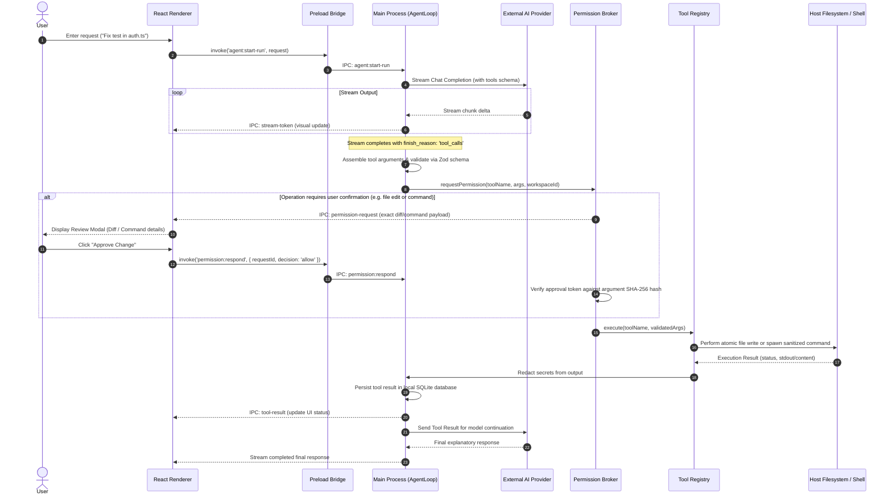
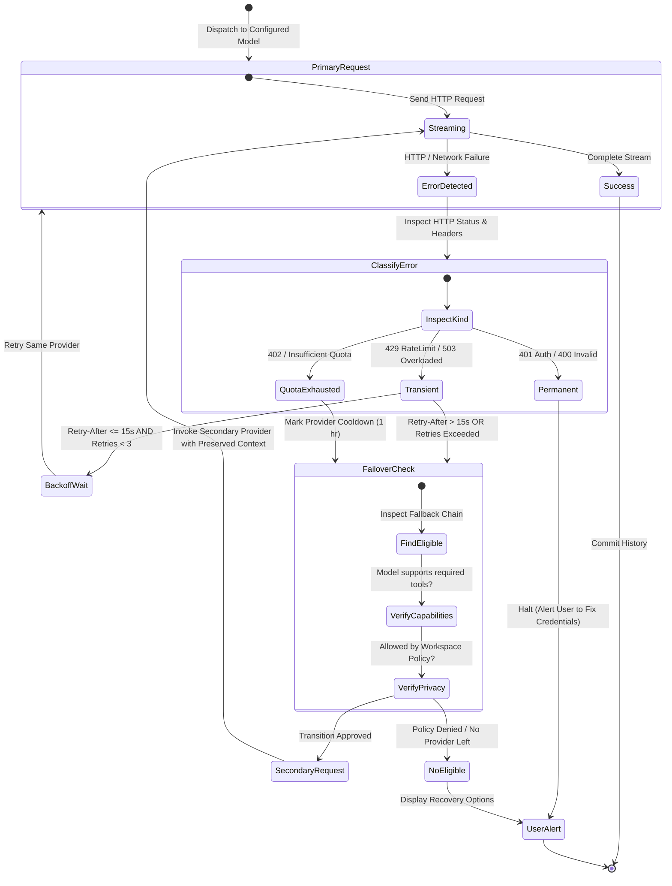
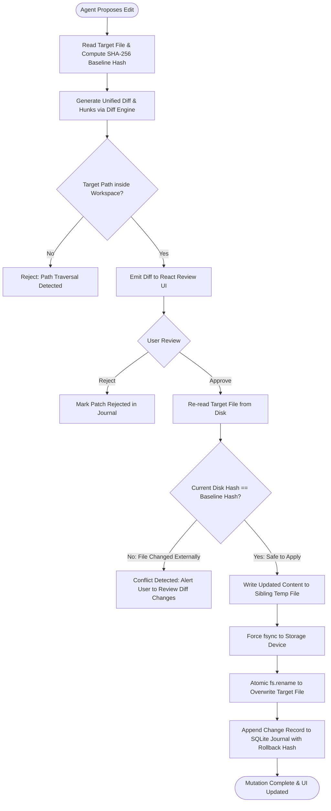

# System Architecture & Process Boundaries

*Date of Verification: October 2026*  
*Status: Approved Engineering Architecture*

---

## 1. High-Level Process Architecture

The desktop application is engineered around strict process boundaries adhering to the Electron security model. The architecture separates the untrusted, sandboxed user interface from privileged operating-system orchestration.

```mermaid
graph TD
    subgraph OS ["Operating System (Windows / macOS / Linux)"]
        FS[Host Filesystem]
        Keyring[OS Keyring: DPAPI / Keychain / SecretService]
        Proc[OS Process Spawner]
    end

    subgraph MainProcess ["Electron Main Process (Node.js 24 Privileged Runtime)"]
        AppLifecycle[App Lifecycle & Window Manager]
        IPCRouter[IPC Router & Sender Validation]
        
        subgraph CoreServices ["Core Application Services"]
            SecretStore[SecretStorageService (safeStorage Async)]
            Database[(node:sqlite DatabaseSync)]
            WorkspaceSvc[Workspace & Safe FS Service]
            AgentRunner[Agent Command Runner (child_process.spawn)]
            UserPTY[User Terminal Shell Service]
        end

        subgraph AgentEngine ["Agent & Provider Subsystem"]
            ProviderRouter[Provider Router & Failover Engine]
            ProviderAdapters[Provider Adapters: Gemini, Groq, Cerebras, OpenRouter]
            AgentRuntime[Agent Orchestration Loop]
            ToolRegistry[Central Tool Registry]
            Broker[Central Permission Broker]
        end
    end

    subgraph PreloadBridge ["Isolated Preload Layer"]
        Bridge[contextBridge.exposeInMainWorld: window.electronApi]
    end

    subgraph RendererProcess ["Sandboxed Renderer Process (Chromium + React 19)"]
        StateMgr[Zustand / React Context State]
        UIViews[React Views: Chat, Providers, Terminal, Diff Viewer, Modals]
        XTermUI[xterm.js Canvas UI Component]
    end

    %% Wiring
    UIViews --> StateMgr
    StateMgr --> Bridge
    XTermUI --> Bridge
    Bridge -->|Narrow Typed IPC| IPCRouter
    IPCRouter --> Broker
    IPCRouter --> ProviderRouter
    IPCRouter --> WorkspaceSvc
    IPCRouter --> UserPTY

    Broker --> ToolRegistry
    ToolRegistry --> WorkspaceSvc
    ToolRegistry --> AgentRunner
    
    ProviderRouter --> ProviderAdapters
    ProviderAdapters --> SecretStore
    
    SecretStore --> Keyring
    Database --> FS
    WorkspaceSvc --> FS
    AgentRunner --> Proc
    UserPTY --> Proc
```

---

## 2. Process Separation & Responsibilities

### A. Electron Main Process (`src/main/`)
* **Privilege Level:** Highly Privileged (Node.js runtime).
* **Core Responsibilities:**
  - Window creation with mandatory security options (`contextIsolation: true`, `nodeIntegration: false`, `sandbox: true`).
  - Secure credential storage and retrieval via OS keychain (`safeStorage`).
  - Structured local data persistence using Node's built-in `node:sqlite` (`DatabaseSync`).
  - Central permission broker and policy enforcement.
  - Safe workspace path resolution and atomic file mutation.
  - Provider request dispatch, streaming token buffering, retry backoff, and cross-provider failover.
  - Agent structured command execution with resource limits and process-tree termination.
  - User terminal session spawning and bi-directional PTY/pipe IPC streaming.

### B. Preload Script (`src/preload/`)
* **Privilege Level:** Sandboxed Bridge.
* **Core Responsibilities:**
  - Runs in an isolated context prior to any renderer script execution.
  - Exposes an immutable, typed `window.electronApi` object via Electron's `contextBridge.exposeInMainWorld()`.
  - **Zero Unrestricted IPC:** Does NOT expose `ipcRenderer` or raw event dispatchers to the window object. Every API method is an explicit, strongly typed function with contract validation.

### C. Renderer Process (`src/renderer/`)
* **Privilege Level:** Completely Sandboxed (Chromium Web Environment).
* **Visual Blueprint:** Built strictly to the **VersaRail AI** design system specified in [`docs/UI_UX_SPECIFICATION.md`](UI_UX_SPECIFICATION.md).
* **Core Responsibilities:**
  - Rendering the React 19 UI: 40px custom titlebar, 256px main sidebar, fluid center chat & execution timeline, 288px right inspector panel (Files, Activity, Changes), and anchored composer.
  - Presenting specialized views: Welcome Hero, AI Providers Gateway Dashboard, Task History, Usage & Quotas, and Settings.
  - Capturing user interactions (keyboard shortcuts, prompt composer, credential forms, diff approvals).
  - Displaying real-time streaming tokens, diff visualizations, and approval dialogs.
  - **Security Restrictions:** Strictly forbidden from accessing Node.js primitives, filesystem APIs, shell execution, or raw API keys after persistence.

### D. Utility Process Evaluation
* Electron Utility Processes (`utilityProcess.fork`) provide process isolation and crash containment for heavy background tasks.
* **Architectural Decision:** We isolate heavy CPU-bound tasks (such as large diff generation or high-throughput JSON streaming) within worker threads or main services. We avoid using utility processes as a pseudo-security sandbox, since utility processes have Node capabilities and require privileged IPC to access secret storage or workspace files.

---

## 3. End-to-End Execution Flows

### A. Agent Tool Execution Pipeline

The agent loop executes through a non-bypassable, multi-stage pipeline where model outputs are validated, authorized, and audited before any privileged action is taken.



---

### B. Failover & Retry State Machine

When a provider request encounters rate limits, timeouts, or quota limits, the router classifies the error and executes the state machine:



---

### C. Diff Review & Atomic File Mutation Engine

To prevent silent file overwrites and race conditions with external file edits (e.g., changes made in VS Code or Git), file modifications follow an atomic, verified sequence:



---

### D. Dual Terminal Execution Architecture

To prevent prompt injection from executing malicious commands in an interactive session, the application separates the terminal subsystem into two distinct implementations:

```
+-------------------------------------------------------------------------+
|                           REACT USER INTERFACE                          |
|                                                                         |
|  [Tab 1: Developer Shell (xterm.js)]    [Tab 2: Agent Activity Logs]    |
+-------------------------------------------------------------------------+
                    |                                        |
                    | (Direct Keystrokes & Resizes)          | (Approval Dialogs & Read-only logs)
                    v                                        v
+------------------------------------+  +---------------------------------+
|     USER TERMINAL SERVICE          |  |      AGENT COMMAND RUNNER       |
|     (src/main/terminal/)           |  |      (src/main/agent/)          |
|                                    |  |                                 |
| - Connects user to interactive PTY |  | - Structured arguments array    |
| - Unrestricted developer input     |  |   ['npm', 'test', '--', '-u']   |
| - PTY streaming via IPC            |  | - Enforces PermissionBroker     |
| - NEVER accepts programmatic       |  | - Strips dangerous env vars     |
|   commands from AI model           |  | - Process-tree termination      |
|                                    |  | - Redacts secrets from stdout   |
|                                    |  | - 1MB buffer cap & timeout      |
+------------------------------------+  +---------------------------------+
                    |                                        |
                    v                                        v
        Host Shell (PowerShell/Bash)                child_process.spawn
```

---

## 4. IPC Architecture & Typed Contracts

Communication between processes occurs strictly through asynchronous request-response handlers (`ipcMain.handle` / `ipcRenderer.invoke`) and unidirectional event channels (`webContents.send`).

### IPC Channel Registry

| Channel Name | Direction | Payload Contract (Zod Validated) | Description |
| :--- | :--- | :--- | :--- |
| `providers:list` | Renderer → Main | `void` | Returns list of configured providers and health status (keys masked). |
| `providers:save-credential` | Renderer → Main | `{ providerId, label, apiKey, customEndpoint? }` | Validates and encrypts credential via `safeStorage`. |
| `providers:delete-credential`| Renderer → Main | `{ credentialId }` | Removes credential from secure store. |
| `models:list-available` | Renderer → Main | `{ providerId? }` | Returns capability-annotated models available for selection. |
| `agent:start-conversation` | Renderer → Main | `{ workspaceId, initialPrompt, modelRoutingPolicy }` | Initializes conversation and starts agent run. |
| `agent:cancel-run` | Renderer → Main | `{ runId }` | Triggers `AbortController` and halts active tool/command. |
| `agent:stream-token` | Main → Renderer | `{ runId, token, deltaType }` | Streams incremental text chunks to React UI. |
| `permission:request` | Main → Renderer | `PermissionRequestPayload` | Presents approval modal to developer. |
| `permission:respond` | Renderer → Main | `{ requestId, decision: 'allow' \| 'deny', rememberScope }` | Submits authorization decision to `PermissionBroker`. |
| `workspace:select-folder` | Renderer → Main | `void` | Triggers native OS folder picker dialog. |
| `workspace:inspect-files` | Renderer → Main | `{ workspaceId, relativeDir? }` | Returns canonical file tree within workspace root. |
| `terminal:create-session` | Renderer → Main | `{ workspaceId, shellPath? }` | Spawns interactive user terminal instance. |
| `terminal:write` | Renderer → Main | `{ sessionId, data: string }` | Sends user keystrokes to terminal shell. |
| `terminal:data` | Main → Renderer | `{ sessionId, data: string }` | Streams terminal output bytes to xterm.js. |
| `diff:apply-patch` | Renderer → Main | `{ patchId, approvedHunkIndices: number[] }` | Applies approved patch hunks atomically. |

---

## 5. Cancellation & Resource Cleanup Protocol

When a user clicks "Cancel" or closes the window:
1. The Main Process triggers the `AbortController.abort()` attached to the active AI provider HTTP stream.
2. If an agent command is actively executing in `AgentCommandRunner`, the runner immediately triggers process-tree termination (`tree-kill` or OS-equivalent `taskkill /F /T`) to kill both the root executable and any spawned subprocesses.
3. Any pending tool calls queued in memory are invalidated.
4. The database records the run state as `cancelled`.
5. The UI transitions immediately to an idle state with zero dangling locks or lingering memory listeners.
