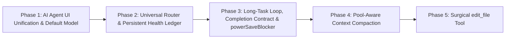

# Master Plan: Universal AI Agent Auto-Switching Mesh & Long-Task Runtime

**Architecture Specification & Implementation Plan**  
*Target: VersaRail AI Agent Harness (Electron + Node.js + TypeScript + React)*  
*Reference Architectures: `freellmapi-main` (Dynamic Bandit Router, Cooldown Probes, Rate Window Leases) & `kilocode-main` (Unified Agent Session Loop, Overflow Compaction, Stateless Replay)*  
*Version: 3.0.0-AGENT-UNIFIED*  
*Status: Approved for Execution*

---

## 1. Core Principle: The Unified "AI Agent" Persona

### The Flaw in the Old UI
As revealed in real testing:
- Assistant message cards were labeled with raw technical model names: `openai`, `gemini-2.5-pro`, `kilo-auto/free`, `meta-llama/...`.
- When an auto-failover occurred, the header suddenly changed between different names in the same chat turn.
- The composer placeholder said *"Ask gemini-2.5-pro to modify code..."*.

This leaked backend plumbing into the user experience, broke user immersion, and made auto-switching look like a glitch rather than a feature.

### The New Architecture: A Single Unified "AI Agent"
- **User Perspective:** The user is conversing with one unified **AI Agent** (VersaRail AI Agent).
- **Sender Header:** Cleanly displays **`AI Agent`** for all assistant turns, accompanied by an optional, subtle telemetry pill (e.g. `⚡ Auto: Gemini 2.5 Flash`) that informs without cluttering.
- **Composer:** Defaults to `⚡ AI Agent (Auto-Switch)` with the clean placeholder:
  `Ask AI Agent to modify code, run tests, or type @ to mention files... (Enter to send)`
- **Behind the Scenes:** The engine operates a multi-provider intelligence mesh orchestrating **Google Gemini, Mistral AI, GroqCloud, Cerebras, NVIDIA NIM, OpenRouter Free, Kilo Gateway, and Pollinations**. If Gemini rate-limits, the agent switches to Mistral or Groq without renaming the chat persona or resetting state!

---

## 2. Best-in-Class Patterns Adapted from `freellmapi` & `kilocode`

From a deep audit of `freellmapi-main` and `kilocode-main`, we extract the four most effective battle-tested patterns:

```
┌────────────────────────────────────────────────────────────────────────────────────────┐
│                              PROVEN PATTERN INGESTION                                  │
├───────────────────────────────┬────────────────────────────────────────────────────────┤
│ Proven Pattern from Reference │ How We Implement It in VersaRail AI                    │
├───────────────────────────────┼────────────────────────────────────────────────────────┤
│ 1. `freellmapi/services/`     │ Multi-Provider Router with Provider-Level LRU          │
│    `router.ts` & `scoring.ts` │ Pool free BYOK tiers (Gemini, Mistral, Groq, Cerebras) │
│                               │ and keyless tiers. Rotate across *different providers* │
│                               │ so no single hourly IP limit is tripped.               │
├───────────────────────────────┼────────────────────────────────────────────────────────┤
│ 2. `freellmapi/services/`     │ Persistent SQLite Health Ledger & All-Cooling State    │
│    `ratelimit.ts` & `health.ts│ Persist cooldowns, strikes, and reset epochs to disk. │
│                               │ If all providers cool down, sleep until the earliest   │
│                               │ reset with a live UI countdown; NEVER fail the task!   │
├───────────────────────────────┼────────────────────────────────────────────────────────┤
│ 3. `kilocode/session/`        │ Pool-Aware Context Compaction                          │
│    `compaction.ts` &          │ Budget context against min(pool context windows) so    │
│    `overflow.ts`              │ failover to a smaller model (e.g. Mistral 32k) never   │
│                               │ causes context window overflow mid-task.               │
├───────────────────────────────┼────────────────────────────────────────────────────────┤
│ 4. `kilocode/session/`        │ Long-Task Agent Loop with Completion Contract          │
│    `processor.ts` & `retry.ts`│ Extended tool loops (25-50 steps) with `task_complete` │
│                               │ contract and Electron `powerSaveBlocker` sleep guard.  │
└───────────────────────────────┴────────────────────────────────────────────────────────┘
```

---

## 3. Universal Multi-Provider Free-Tier Ecosystem

The engine automatically pools any configured keys or keyless fallbacks into the active agent brain:

```mermaid
flowchart TD
    User["User Prompt to 'AI Agent'"] --> Router["Universal Agent Router (Policy: auto/free)"]
    Ledger["Durable Health Ledger (SQLite)"]
    Router <--> Ledger

    subgraph FreeMesh ["Universal Free Intelligence Mesh"]
        Gemini["Google Gemini (1M Context · Reasoning)"]
        Mistral["Mistral AI (Codestral · 256k · Code Engine)"]
        Groq["GroqCloud (Llama 3.3 70B · Fast Tokens)"]
        Cerebras["Cerebras (Llama 3.3 · High Throughput)"]
        Nvidia["NVIDIA NIM (Nemotron / Llama 3.3)"]
        OpenRouter["OpenRouter (:free Catalog)"]
        Kilo["Kilo Gateway (kilo-auto/free · Keyless)"]
        Pollinations["Pollinations (GPT-OSS 20B · Keyless)"]
    end

    Router --> Gemini
    Gemini -.->|429 Rate Limit (15 RPM)| Mistral
    Mistral -.->|Quota Limit| Groq
    Groq -.->|30 RPM Limit| Cerebras
    Cerebras -.->|Temporary Cooldown| Kilo
    Kilo -.->|All Cooling| WaitEngine["All-Cooling Wait Engine (Live Countdown)"]
    WaitEngine -->|Earliest Reset Elapses| Router
```

---

## 4. The 5 Core Upgrades

### Upgrade 1: Unified AI Agent Persona & Clean UI
- **Sender Label:** `AI Agent` on every assistant message.
- **Telemetry Pill:** Small, subtle indicator (e.g. `⚡ auto: gemini-2.5-flash`) so the user knows what powered the turn without turning the chat into a raw model ticker.
- **Composer Selector:** `⚡ AI Agent (Auto-Switch)` as the default. Also supports `AI Agent · Auto (Fast)` and `AI Agent · Auto (Best)`.

### Upgrade 2: Universal Router with Provider-Level LRU Rotation
- **Policy Engine:** `auto/free` resolves dynamically per LLM turn across all healthy free candidates.
- **Provider LRU:** Rotates among *different providers* (Gemini $\to$ Mistral $\to$ Groq $\to$ Cerebras $\to$ Kilo) to spread load across independent IP and account quotas.
- **Dead-Turn Replay:** If an API drops or rate-limits before first token, the engine immediately flags the candidate, picks the next provider, and replays the prompt invisibly.

### Upgrade 3: Persistent Health Ledger & The All-Cooling Never-Die State
- **SQLite Persistence:** Table `provider_health` stores status (`ok`, `cooldown`, `dead`), consecutive strikes, and reset epochs. Survives app restarts.
- **All-Cooling Sleep Engine:** If all free models are in cooldown, calculate $\tau = \min(\text{cooldownUntil})$, display a live countdown in the chat (*"All providers cooling. Resuming in 22s..."*), wait using an interruptible timer, and resume automatically.

### Upgrade 4: Pool-Aware Context Compaction
- Compaction evaluates after every tool step against:
  $$\text{ContextFloor} = \min_{c \in \text{PolicyPool}} (\text{candidate.contextWindow})$$
- Safe operating threshold = $0.75 \times \text{ContextFloor}$.
- When tokens exceed the threshold, older turns are summarized into a pinned milestone so mid-task failover to a smaller model never causes context window overflow.

### Upgrade 5: Long-Task Endurance & Surgical File Editing
- **Extended Loop:** Replace hardcoded 5 steps with 25–50 steps.
- **Surgical `edit_file`:** Takes `{ path, targetContent, replacementContent }`, replaces specific blocks by pattern matching, and generates diffs for review.
- **OS Sleep Guard:** Uses Electron `powerSaveBlocker` to ensure background tasks aren't killed by Windows sleep.

---

## 5. Execution Roadmap



1. **Phase 1: AI Agent UI Unification**
   - Clean message headers in `ChatView.tsx` to `AI Agent` with subtle auto-routing telemetry.
   - Update `PromptComposer.tsx` and `useUiStore.tsx` to make `AI Agent (Auto-Switch)` the primary default.
2. **Phase 2: Universal Router & Persistent Health Ledger**
   - Implement `router.ts` with `auto/free` aggregating Gemini, Mistral, Groq, Cerebras, NVIDIA, Kilo, Pollinations.
   - Create SQLite table `provider_health` with persistent strikes and cooldowns.
   - Implement the All-Cooling wait engine with live UI countdown.
3. **Phase 3: Long-Task Loop & Completion Contract**
   - Expand `AgentRuntime` tool loop to 25–50 steps with `task_complete` tool.
   - Wire Electron `powerSaveBlocker` to active runs.
4. **Phase 4: Pool-Aware Context Compaction**
   - Upgrade `context-manager.ts` to compact context based on $\min(\text{contextWindow})$ of the active candidate pool.
5. **Phase 5: Surgical `edit_file` Tool**
   - Implement `edit-file.tool.ts` and integrate with `ToolRegistry` and `system-prompt.ts`.

---

## 6. Verification Gates
- `npm run typecheck`: 0 errors.
- `npm test`: 100% test suites passing.
- `npm run build`: Production bundle builds cleanly.
- End-to-end task test: Multi-turn coding task using `AI Agent` with seamless failover across Gemini, Mistral, and Groq.
