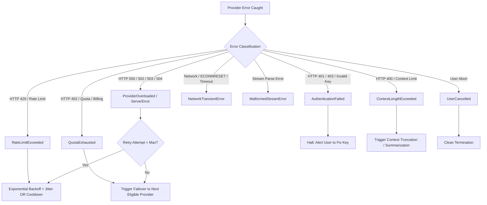

# Provider Strategy & Model Registry

*Date of Verification: October 2026*  
*Status: Verified Official Specifications*

---

## 1. Overview & Provider Adapter Contract

The application implements a decoupled, capability-aware **Provider Adapter System**. Rather than hardcoding provider-specific quirks into the agent loop or UI components, all provider interactions conform to the `IProviderAdapter` contract in the Electron Main process.

```typescript
export interface IProviderAdapter {
  readonly id: ProviderId;
  readonly name: string;
  readonly capabilities: ProviderCapabilities;

  validateCredential(apiKey: string, customEndpoint?: string): Promise<CredentialValidationResult>;
  listModels(apiKey: string, customEndpoint?: string): Promise<ModelDescriptor[]>;
  streamChat(
    request: ProviderChatRequest,
    callbacks: StreamCallbacks,
    signal: AbortSignal
  ): Promise<ProviderChatResponse>;
  mapError(error: unknown): NormalizedProviderError;
}
```

---

## 2. Verified Candidate Providers

### A. Google Gemini (Google AI Studio)

* **Documentation:** [https://ai.google.dev/gemini-api/docs](https://ai.google.dev/gemini-api/docs)
* **SDK Choice:** `@google/genai` (Current Unified GA SDK; replaces deprecated `@google/generative-ai` whose maintenance ended in August 2025).
* **Authentication:** API Key passed via header `x-goog-api-key` or client initialization.
* **Endpoint Base:** `https://generativelanguage.googleapis.com`

#### Verified Models & Capabilities

| Model ID | Context Window | Output Limit | Tool Calling | Structured Output | Verified Free Tier Status |
| :--- | :--- | :--- | :--- | :--- | :--- |
| `gemini-2.5-flash` | 1,000,000 tokens | 8,192 tokens | Yes | Yes | Available (Subject to 15 RPM / 1M TPM / 1,500 RPD limits) |
| `gemini-2.5-pro` | 2,000,000 tokens | 8,192 tokens | Yes | Yes | Available (2 RPM / 32k TPM / 50 RPD on free tier) |
| `gemini-2.0-flash` | 1,000,000 tokens | 8,192 tokens | Yes | Yes | Available (15 RPM / 1M TPM / 1,500 RPD) |

#### Privacy & Terms Note
Google AI Studio's Free Tier terms state that input/output data may be logged and reviewed by human reviewers to train and improve Google products. The application UI must explicitly alert the user to this policy before dispatching workspace code on the Free Tier, allowing users with Paid/Vertex keys or strict data policies to restrict data egress.

---

### B. Groq (GroqCloud LPU Inference)

* **Documentation:** [https://console.groq.com/docs](https://console.groq.com/docs)
* **SDK Choice:** `groq-sdk` (Official TypeScript SDK, OpenAI-compatible architecture)
* **Authentication:** Bearer token via `Authorization: Bearer <GROQ_API_KEY>`
* **Endpoint Base:** `https://api.groq.com/openai/v1`

#### Verified Models & Capabilities

| Model ID | Context Window | Output Limit | Tool Calling | Structured Output | Verified Free Tier Status |
| :--- | :--- | :--- | :--- | :--- | :--- |
| `llama-3.3-70b-versatile` | 128,000 tokens | 32,768 tokens | Yes | Yes | Free Developer Tier (30 RPM, 1,000 RPD, 6,000 TPM limit) |
| `llama-3.1-8b-instant` | 128,000 tokens | 8,192 tokens | Yes | Yes | Free Developer Tier (30 RPM, 14,400 RPD, 20,000 TPM limit) |
| `mixtral-8x7b-32768` | 32,768 tokens | 4,096 tokens | Yes | Yes | Free Developer Tier (30 RPM, 14,400 RPD) |

#### Strengths
Industry-leading token generation speed (typically 250–500+ tokens/sec), making streaming feedback instantaneous for developers. Supports native OpenAI-format tool calling.

---

### C. Cerebras (Cerebras Cloud Inference)

* **Documentation:** [https://cerebras.ai/developers](https://cerebras.ai/developers)
* **SDK Choice:** `@cerebras/cerebras_cloud_sdk`
* **Authentication:** Bearer token via `Authorization: Bearer <CEREBRAS_API_KEY>`
* **Endpoint Base:** `https://api.cerebras.ai/v1`

#### Verified Models & Capabilities

| Model ID | Context Window | Output Limit | Tool Calling | Structured Output | Verified Status |
| :--- | :--- | :--- | :--- | :--- | :--- |
| `llama3.3-70b` | 128,000 tokens | 8,192 tokens | Yes | Yes | High-speed wafer-scale engine inference |
| `llama3.1-8b` | 8,192 / 128k | 8,192 tokens | Yes | Yes | Low latency code completion |
| `qwen-3.8-27b` | 32,768 tokens | 4,096 tokens | Yes | Yes | Developer tier support |

#### Strengths
Ultra-high throughput streaming on CS-3 hardware, OpenAI-compatible streaming delta events for tool call parsing.

---

### D. OpenRouter (Multi-Model Gateway)

* **Documentation:** [https://openrouter.ai/docs](https://openrouter.ai/docs)
* **Client Architecture:** OpenAI-compatible Fetch client with standard `Authorization: Bearer <OPENROUTER_API_KEY>`
* **Endpoint Base:** `https://openrouter.ai/api/v1`
* **Model Discovery Endpoint:** `GET https://openrouter.ai/api/v1/models` (filterable by `supported_parameters=tools`)

#### Verified Models & Capabilities

| Model Pattern | Context Window | Tool Calling | Description |
| :--- | :--- | :--- | :--- |
| `meta-llama/llama-3.3-70b-instruct:free` | 131,072 tokens | Yes | Free tier community model with function calling |
| `google/gemini-2.0-flash-exp:free` | 1,048,576 tokens | Yes | Experimental free tier access via OpenRouter |
| Standard Paid Models | Model-dependent | Yes | Access to Claude 3.5 Sonnet, GPT-4o, DeepSeek, etc. |

#### Strengths
Aggregates hundreds of models behind a single credential; supports dynamic model capability inspection.

---

### E. Custom OpenAI-Compatible Endpoints (Local & Enterprise)

* **Scope:** Local Ollama, vLLM, LM Studio, or Private Enterprise Gateways.
* **Security Constraints:**
  - Mandatory URL validation using WHATWG `URL`.
  - HTTPS enforced for non-loopback endpoints.
  - Protection against Server-Side Request Forgery (SSRF): Loopback (`127.0.0.1`, `localhost`) allowed only when the user explicitly flags the endpoint as a "Local Development Runtime". Cloud metadata addresses (`169.254.169.254`, `metadata.google.internal`) are strictly forbidden.
  - Model responses are untrusted and forbidden from reconfiguring or redirecting endpoint URLs.

---

## 3. Error Taxonomy & Classification Matrix

When an API call fails, the adapter must not throw an opaque string. It normalizes the failure into `NormalizedProviderError` with a structured `ErrorKind`:



### Complete Classification Matrix

| Error Kind | HTTP Status / Codes | Transient? | Retry Strategy | Eligible for Failover? | User Notification |
| :--- | :--- | :--- | :--- | :--- | :--- |
| `RateLimitExceeded` | 429, `rate_limit_exceeded` | Yes | Parse `Retry-After` header; exponential backoff (1s, 2s, 4s + jitter). If `retry-after > 15s`, trigger failover. | Yes | "Provider rate limit reached. Retrying or switching to fallback..." |
| `QuotaExhausted` | 429 (monthly quota), 402, `insufficient_quota` | No (for current period) | Do NOT retry on same credential. Mark provider in 1-hour cooldown. | Yes | "Provider quota exhausted. Failing over to configured secondary provider." |
| `AuthenticationFailed` | 401, `invalid_api_key` | No | Halt immediately. Do NOT retry. Do NOT failover to hide invalid key. | No | "API key invalid or expired. Please update credentials in Provider Dashboard." |
| `PermissionDenied` | 403, `forbidden` | No | Halt. Do NOT retry. | No | "Credential lacks permission for requested model or tier." |
| `BillingRestriction` | 402, `billing_not_active` | No | Halt. Do NOT retry. | Yes (if alternative provider exists) | "Account billing inactive or payment required." |
| `ContextLengthExceeded`| 400, `context_length_exceeded`| No (with same payload)| Truncate conversation context history and retry once. | Yes (if fallback has larger context) | "Context window exceeded. Truncating history..." |
| `ProviderOverloaded` | 503, 529, `service_unavailable` | Yes | 2 bounded retries with jitter. If still failing, trigger failover. | Yes | "Provider temporarily overloaded. Switching to standby provider." |
| `NetworkTransientError`| `ECONNRESET`, `ETIMEDOUT`, DNS | Yes | 2 retries (500ms, 1500ms). If host unreachable, failover. | Yes | "Network connectivity issue detected." |
| `MalformedStreamError`| Unexpected EOF, chunk parse error| Yes | Check if partial output was rendered; do NOT duplicate side effects. | Yes (clean restart only) | "Stream interrupted by provider." |
| `UserCancelled` | AbortSignal triggered | N/A | Terminate immediately. Clean up active handles. | No | "Generation cancelled by user." |

---

## 4. Automatic Failover Engine Specification

### Failover Policy Principles
1. **Preserve User Intent:** Never silently downgrade capabilities (e.g. switching to a model that does not support tool calling when the agent is executing an active tool workflow).
2. **Data-Sharing & Privacy Gating:** Before switching from Provider A (e.g. Local/Enterprise) to Provider B (e.g. Public Cloud Free Tier), verify that Provider B is permitted by the active workspace data policy.
3. **No Duplicate Execution:** If generation fails *after* a tool has been executed, the tool result is already locked into the conversation history. The fallback model is invoked with the completed tool output; the tool is NEVER re-executed.
4. **Transparent UI Transitions:** Failover events are prominently displayed in the chat and agent activity feed:
   > *"Notice: Groq (llama-3.3-70b-versatile) returned Rate Limit 429. Auto-failing over to Google Gemini (gemini-2.5-flash)."*

### Health & Cooldown Tracking Table
The Main Process maintains an in-memory and persisted `ProviderHealthTracker`:
```typescript
export interface ProviderHealthState {
  providerId: ProviderId;
  status: 'healthy' | 'degraded' | 'cooling_down' | 'unauthenticated' | 'quota_exhausted';
  consecutiveFailures: number;
  cooldownUntil?: number; // Epoch timestamp
  lastErrorMessage?: string;
  activeRequests: number;
}
```

---

## 5. Streaming & Tool Call Accumulation Protocol

OpenAI-compatible providers stream tool calls across incremental delta fragments:
- Chunk 1: `{ delta: { tool_calls: [{ index: 0, id: "call_1", function: { name: "read_file" } }] } }`
- Chunk 2: `{ delta: { tool_calls: [{ index: 0, function: { arguments: "{\"path\":" } }] } }`
- Chunk 3: `{ delta: { tool_calls: [{ index: 0, function: { arguments: " \"src/index.ts\"}" } }] } }`

The adapter protocol guarantees:
1. **Delta Assembly:** Accumulates raw argument fragments into a single string buffer keyed by `tool_call_id`.
2. **Zero Incomplete Execution:** The tool runner NEVER receives partial JSON. The stream must reach a complete `finish_reason: "tool_calls"` before JSON parsing and schema validation are triggered.
3. **Parse Validation:** If the assembled JSON is invalid, the adapter feeds a structured validation error back into the conversation context, prompting the model to re-issue the tool call with corrected syntax, without crashing the harness.
